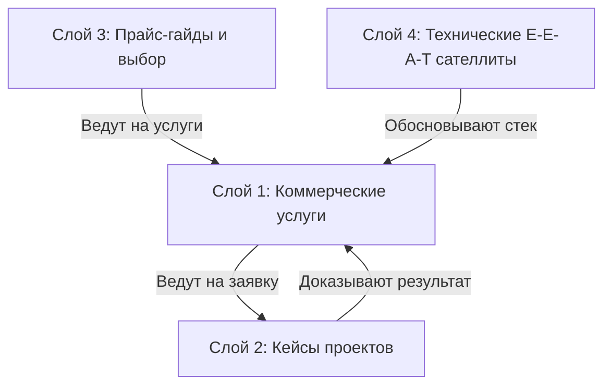

# Карта интентов блога FastUp.by: защита от каннибализации и 100% покрытие спроса

**Дата составления:** 16 августа 2026  
**Цель:** Развести 15 записей блога, 5 посадочных страниц услуг и 8 кейсов на непересекающиеся поисковые интенты, исключить внутреннюю конкуренцию страниц в Яндексе/Google/нейросетях и обеспечить бесшовную перелинковку.

---

## 1. Фундаментальный принцип разделения (Матрица слоев)

Чтобы страницы не конкурировали друг с другом за одни и те же поисковые фразы, контент делится на 4 изолированных слоя с четкими границами:

1. **Коммерческий слой (Транзакционный):** Прямая продажа услуг с открытыми ценами от 800–1100 BYN.
2. **Кейсы (Фактоидный / Доказательный):** Реальные цифры, сроки и решения конкретных проектов без общих ценовых H2.
3. **Прайс-гайды и выбор (Сравнительный / Навигационный):** Помощь клиенту в выборе формата, бюджета и подрядчика.
4. **Экспертные E-E-A-T сателлиты (Инженерный / Информационный):** Глубокие технические гайды, исследования, бенчмарки и инструменты.

---

## 2. Разбор 15 статей блога по кластерам спроса

### Кластер A. GEO-продвижение и нейросети (ИИ-поиск)

В этом кластере находилось 7 статей и 2 страницы услуг. Здесь был наивысший риск внутренней конкуренции.

| URL / ID | Заголовок статьи | Целевой интент (БЕЗ пересечений) | Главный поисковый вопрос | Куда ведет конверсия |
|---|---|---|---|---|
| **`/geo-prodvizhenie/`** *(Стр. услуги 2850)* | GEO-продвижение сайтов в нейросетях | **Транзакционный заказ услуги:** аудит 500 BYN, ведение от 800 BYN/мес, бриф, сроки. | *«Где заказать GEO-продвижение в нейросетях в Беларуси?»* | Форма заявки на аудит |
| **`/geo-audit-system/`** *(Стр. стандарта 2869)* | FastUp GAS: Открытый стандарт аудита | **Методология и формулы:** расчет NVI, CBK, PKS, PCL, CLI утилита на PyPI. (0 mentions BYN). | *«Как математически измерить видимость сайта в ИИ?»* | Ссылка на GitHub / PyPI |
| **`post: 2948`** *(Лонгрид)* | Оптимизация сайтов под нейросети: GEO, AEO и GAS | **Обзор технологий ИИ-поиска:** разница SEO vs GEO vs AEO, разрыв цитирования (SCG), граф знаний. | *«Что такое GEO и AEO оптимизация простыми словами?»* | `/geo-prodvizhenie/` |
| **`post: 2930`** *(Инженерный)* | Почему сайт из ТОП-1 не попадает в ответы нейросетей | **Проблема индексации и доверия:** почему синих ссылок в ТОП-1 мало для генеративного ИИ. | *«Почему сайт на 1 месте в Яндексе, но ChatGPT его не видит?»* | `/keys-geo-prodvizhenie/` |
| **`post: 2340`** *(E-E-A-T мифы)* | GEO не про блокировки ботов | **Технические заблуждения:** разбор robots.txt (GPTBot, ClaudeBot) vs реальная ценность E-E-A-T. | *«Нужно ли блокировать краулеры нейросетей в robots.txt?»* | `/geo-audit-system/` |
| **`post: 2447`** *(How-To гайд)* | Как я проверяю, видит ли нейросеть сайт клиента | **Практический туториал:** пошаговая ручная проверка через промпты и бесплатный запуск утилиты. | *«Как самостоятельно проверить видимость бизнеса в ChatGPT?»* | `/geo-prodvizhenie/` |
| **`post: 2938`** *(Анонс)* | Книга «FastUp GEO: Эволюция поисковых систем» | **Скачивание книги:** PDF/DOCX версии, оглавление 5 глав, статус модерации Rideró. | *«Где скачать книгу по GEO-продвижению и SEO 4.0?»* | Кнопки скачивания |
| **`post: 2857`** *(469 слов ⚠️)* | *Решение по слабой статье:* | **Переформатировать в «Чек-лист экспресс-подготовки сайта к GEO за 5 шагов»** | *«Чек-лист аудита готовности сайта к поисковым нейросетям»* | `/geo-prodvizhenie/` |

---

### Кластер B. Сравнение платформ, CMS и скорость (Web Engineering)

| URL / ID | Заголовок статьи | Целевой интент | Главный поисковый вопрос | Куда ведет конверсия |
|---|---|---|---|---|
| **`post: 2506`** | WordPress или Тильда: что выбрать в 2026 | **Сравнение на старте проекта:** архитектура, владение кодом, масштабируемость, расходы в 3 года. | *«Что лучше выбрать для бизнеса: WordPress или Tilda?»* | `/razrabotka-saitov/` |
| **`post: 2480`** | Сайт на конструкторе тормозит и не растёт в поиске | **Миграция и лечение:** перенос работающего бизнеса с Tilda/Wix на чистый WordPress. | *«Как перенести сайт с конструктора на WordPress без потери позиций?»* | `/razrabotka-saitov/` |
| **`post: 2769`** | WordPress в зелёную зону Google PageSpeed 100/100 | **Хардкорный техгайд:** TTFB < 150мс, отказ от плагинов-комбайнов, чистая верстка. | *«Как разогнать сайт на WordPress до 100 баллов в Google PageSpeed?»* | `/razrabotka-saitov/` |
| **`post: 2421`** | MicroApps на чистом PHP без БД: 1500 органики | **Авторский кейс Егора Воронова:** философия легковесных инструментов, скорость и E-E-A-T. | *«Как работают микросервисы MicroApps на чистом PHP?»* | `/o-nas/` |

---

### Кластер C. Стоимость, выбор подрядчика и типы сайтов (Коммерческая навигация)

| URL / ID | Заголовок статьи | Целевой интент | Главный поисковый вопрос | Куда ведет конверсия |
|---|---|---|---|---|
| **`post: 2836`** | Сколько стоит сайт в Беларуси в 2026 году | **Прайс-гид по типам сайтов:** реальные вилки цен на рынке, скрытые платежи, из чего состоит смета. | *«Сколько стоит заказать сайт в Беларуси в 2026 году?»* | `/razrabotka-saitov/` |
| **`post: 2448`** | Сколько стоит SEO-продвижение в месяц в Беларуси | **Прайс-гид по SEO:** абонентская плата vs разовые работы, первый месяц от 1000 далее от 800 BYN. | *«Сколько стоит ежемесячное SEO-продвижение сайта в Минске?»* | `/seo-prodvizhenie/` |
| **`post: 2438`** | Как правильно выбрать веб-студию: 7 критериев | **Чек-лист отбора подрядчика:** red flags, юридический договор, проверка портфолио, гарантии. | *«Как выбрать надежную веб-студию для создания сайта?»* | `/razrabotka-saitov/` |
| **`post: 2374`** | Какой сайт лучше подходит вашему бизнесу в 2026 | **Классификатор задач:** лендинг vs мультилендинг vs интернет-магазин vs каталог. | *«Какой тип сайта выбрать: лендинг, каталог или интернет-магазин?»* | `/razrabotka-saitov/` |
| **`post: 1391`** | Entity-First SEO: структурированные данные | **Семантическая микроразметка:** Schema.org (Organization, Service, Person), связь сущностей. | *«Что такое Entity-First SEO и как настроить Schema.org JSON-LD?»* | `/seo-prodvizhenie/` |

---

## 3. Правила перелинковки без каннибализации

1. **Анкоры ссылок ведут только на свои коммерческие хабы:**
   - Анкоры вида *«разработка сайтов на WordPress»*, *«заказать сайт под ключ»* ➔ ведут строго на `/razrabotka-saitov/`.
   - Анкоры вида *«SEO-продвижение сайтов»*, *«поисковая оптимизация»* ➔ ведут строго на `/seo-prodvizhenie/`.
   - Анкоры вида *«GEO-продвижение в нейросетях»*, *«аудит видимости в ИИ»* ➔ ведут строго на `/geo-prodvizhenie/`.
   - Анкоры вида *«стандарт FastUp GAS»*, *«исходный код GAS»* ➔ ведут строго на `/geo-audit-system/`.
2. **В кейсах ценовые H2 всегда персонализированы под проект:**
   - В кейсе СТО: `## Сколько стоит разработка подобного сайта для автосервиса?`
   - В кейсе ремонта балконов: `## Сколько стоит разработка подобного мультилендинга?`
   - В тексте дается вилка цены для аналогичного проекта и ссылка на общую страницу услуги за полным прайсом.
3. **Статья 2857 (слабый дубль 469 слов):**
   - Переименовать H1 и Title в `Чек-лист подготовки сайта к GEO: 5 шагов для цитирования в нейросетях`.
   - Это снимет прямой конфликт с коммерческой страницей `/geo-prodvizhenie/` и превратит слабую статью в практический прикладной чек-лист.
