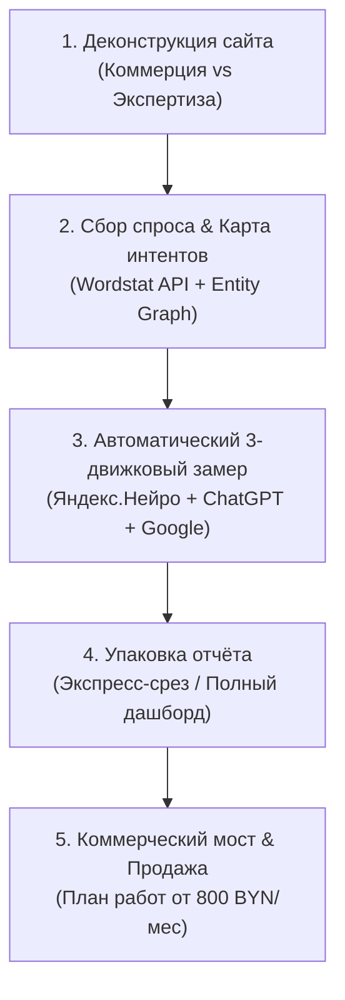
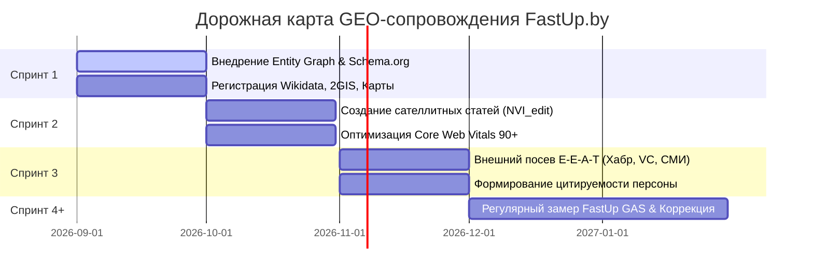

# Полный производственный пайплайн GEO-аудита FastUp GAS (v1.4.1)

Этот документ — пошаговый производственный регламент агентства FastUp.by: как мы берём сайт любого клиента (или собственный проект), деконструируем его, формируем матрицу интентов через Wordstat, проводим автоматический 3-движковый замер по формулам FastUp GAS и конвертируем диагностику в договор ежемесячного GEO-сопровождения.

---

## 0. Статус утверждений этого регламента

Добавлено 2026-08-15. Регламент смешивает отраслевую практику и собственные гипотезы, и на
созвоне с клиентом или на собеседовании это спросят прямо. Разграничение ниже — чтобы не
защищать гипотезу как факт и не занижать то, что реально стоит на документации.

### 🟢 Устоявшаяся практика (есть документация и литература, спорить не о чем)

- Сегментация URL на коммерческий и экспертный слой.
- Сбор спроса и кластеризация запросов, разделение по типам интента.
- Разметка `Schema.org` / JSON-LD, связывание через `sameAs`.
- Согласованность NAP по внешним площадкам; разрешение неоднозначности сущности
  (entity disambiguation) через жёсткие признаки.
- Механика RAG: декомпозиция запроса, извлечение фрагментов, ранжирование пассажей. Отсюда
  же требование самодостаточности блока.
- Медиана нескольких прогонов против разброса ответов LLM (self-consistency).
- Дисциплина замера до/после и наличие базовой линии.
- Core Web Vitals и техническая доступность для краулеров.

### 🟡 Наши гипотезы (применяем, строго не доказаны — так и называть)

- **Что сборка паспорта сущности повышает цитируемость в нейросетях.** Логика прямая и
  правдоподобная, но замера «починили сущность → выросло цитирование» на нескольких проектах
  у нас нет. Есть N=1 по своему сайту.
- **Что 35–45 слов — оптимальный объём блока прямого ответа.** Число взято из наблюдения за
  длиной цитируемых фрагментов, не из эксперимента с вариантами длины.
- **Что покрытие интентов косинусом коррелирует с попаданием в ответы ИИ.** Не проверено;
  вероятно, связь слабая. Косинус применяется как редакторский инструмент, не как прогноз.
- **Что пять метрик (NVI, CBK, PKS, PCL, SCG) предсказывают коммерческий результат.** Они
  корректно измеряют то, что измеряют — упоминания и точность знаний. Связь между ростом
  метрики и ростом заявок мы пока не показали ни на одном проекте.
- **Что порядок спринтов оптимален** (сущность → сателлиты → внешний посев). Логичен, но
  альтернативные порядки не сравнивались.
- **Что структура спроса переносится с российских данных на белорусский рынок.** Для
  сложившихся услуг правдоподобно, для GEO — нет (разная зрелость рынка).

### 🔴 Опровергнуто у нас же (не повторять)

- **Локальная косинусная близость не предсказывает цитирование в ChatGPT и Яндекс.Нейро.**
  Своя модель — не их индекс и не их реранкер. Разбор: `../playbook/geo-method.md`.
- **Порогов косинуса вида «0.85 = лидер рынка» не существует.** Шкала порядковая.
- **Рейтинг конкурентов по своей метрике не является измерением рынка** и наружу не идёт.

### Чего в регламенте нет вообще (известные дыры)

- **Off-page.** Внешние упоминания и подтверждения от независимых источников влияют на ответы
  ИИ сильно, а регламент почти целиком про свой сайт.
- **Контрольная группа.** Страницы, которые не трогали, для сравнения не выделяются — значит
  рост нельзя отделить от общего тренда.
- **Метрика в деньгах.** Переходы из `chatgpt.com` и `perplexity.ai` в GA4 и заявки с них
  не считаются, хотя это самое проверяемое и продаваемое.

---

## 1. Архитектура пайплайна (5 ключевых фаз)

---

## 2. Пошаговый регламент выполнения

### Фаза 1: Деконструкция сайта и URL-картирование (Page Segmentation)

1. **Выгрузка структуры сайта:**
   - Парсинг `sitemap.xml` или обход сайта скриптом / Screaming Frog.
2. **Сегментация URL на два фундаментальных слоя:**
   - **Слой A: Коммерческие посадочные страницы (Commercial Layer):**
     - Услуги, прайс-листы, страницы заказа, каталог, корзина, оферта, контакты.
     - *Задача в ИИ:* прямая конверсия, рекомендация подрядчика/товара.
   - **Слой B: Экспертные информационные страницы (Editorial Layer):**
     - Блог, экспертные статьи, инструкции, чек-листы, исследования, кейсы, FAQ.
     - *Задача в ИИ:* цитирование в качестве первоисточника (E-E-A-T), попадание в сноски `url_citations`.
3. **Технический аудит фундамента:**
   - Проверка микроразметки `Schema.org` (наличие `Organization`, `Service`, `Article`, `DefinedTermSet`, связок `sameAs`).
   - Проверка скорости загрузки PageSpeed Core Web Vitals (мобильный/десктоп).

---

### Фаза 2: Сбор поискового спроса и построение матрицы интентов (Intent Mapping)

1. **Сбор семантики через Яндекс.Вордстат (Wordstat API / XMLRiver):**
   - Выгрузка частотностей фраз по целевому региону (Беларусь / Минск).
2. **Кластеризация не по ключам, а по пользовательским интентам:**
   - В эпоху LLM прямое вхождение слов устарело. Нейросети оперируют смысловыми задачами пользователя (проблемы, критерии выбора, сравнение цен, поиск подрядчика).
3. **Формирование 4-слойной матрицы интентов (`queries_matrix.json`):**
   - **Слой 1: Коммерческие интенты (15–30 запросов)** — запросы на поиск подрядчика, расчет стоимости, сравнение компаний («где заказать сайт в Минске», «кто делает GEO в Беларуси»).
   - **Слой 2: Экспертные интенты (20–50 запросов)** — проблемные и обучающие вопросы, закрываемые статьями («как ускорить WordPress до 90+», «как выбрать веб-студию чек-лист»).
   - **Слой 3: Брендовые интенты компании (CBK) (4–8 запросов)** — проверка фактологической точности знаний ИИ о бренде («что за компания X», «какие цены и услуги у X»).
   - **Слой 4: Персональные интенты спикера / основателя (PKS & PCL) (4–8 запросов)** — авторитет персоны и связка спикер ↔ бренд без наводящих подсказок.
4. **Гео-калибровка промптов:**
   - Для глобальных моделей (ChatGPT) в небрендовые интенты обязательно добавляется региональный маркер (*«в Беларуси»*, *«в Минске»*).

---

### Фаза 3: Автоматический 3-движковый замер (FastUp GAS Engine)

1. **Опрос 3 ключевых ИИ-систем стандарта FastUp GAS:**
   - **Движок 1: Яндекс.Нейро** (через XMLRiver API, `ai=1`, `lr=149` регион Беларусь).
   - **Движок 2: ChatGPT Search** (через RouterAI API: `openai/gpt-4o-mini` с поисковым системным промптом).
   - **Движок 3: Google (BY) / AI Overviews** (через XMLRiver Google API, `country=by`).
2. **Оценка каждого ответа:**
   - **Шкала A (Небрендовая видимость — Коммерция и Экспертиза):**
     - **3 балла:** сайт клиента является **1-м источником** в сносках (`url_citations`).
     - **2 балла:** сайт клиента присутствует в общем списке сносок.
     - **1 балл:** бренд назван в тексте ответа, но активной ссылки нет.
     - **0 баллов:** бренд и сайт полностью отсутствуют.
   - **Шкала B (Знание о бренде и персоне — CBK, PKS, PCL):**
     - **3 балла:** 100% точные факты (услуги, цены, стек) + ссылка.
     - **2 балла:** верное общее описание без ошибок.
     - **1 балл:** неточности / галлюцинации.
     - **0 баллов:** отсутствие ответа.
3. **Расчет 5 формул стандарта FastUp GAS v1.4.1:**
   $$\text{NVI}_{comm} = \frac{\sum \text{коммерческие баллы}}{N_{comm} \times 3} \times 100\%$$
   $$\text{NVI}_{edit} = \frac{\sum \text{экспертные баллы}}{N_{edit} \times 3} \times 100\%$$
   $$\text{NVI}_{total} = \frac{\sum \text{все небрендовые баллы}}{(N_{comm} + N_{edit}) \times 3} \times 100\%$$
   $$\text{CBK} = \frac{\sum \text{баллы бренда}}{N_{brand} \times 3} \times 100\%, \quad \text{PKS} = \frac{\sum \text{баллы персоны}}{N_{person} \times 3} \times 100\%$$
   $$\text{PCL} = \sum \text{баллы связки Спикер} \leftrightarrow \text{Бренд}, \quad \text{SCG} = \text{Разрыв между топом поиска и ИИ-цитированием}$$

---

### Фаза 4: Разделение продуктов: Экспресс-аудит vs Полный аудит

| Параметр | Экспресс-аудит (Lead Magnet) | Полный эталонный аудит (Full Audit) |
|---|---|---|
| **Назначение** | Быстрая квалификация лида, демонстрация проблемы на созвоне (10–15 минут). | Входной платный аудит (300–500 BYN) либо нулевой этап перед абонентским ведением. |
| **Количество интентов** | 10–15 экспресс-запросов (4 коммерция + 4 экспертиза + 2 бренд). | 40–100+ полных интентов по всей карте спроса (120–300+ точек замера). |
| **Охват движков** | 2–3 движка (экспресс-срез). | Все 3 ключевых движка стандарта (Яндекс.Нейро + ChatGPT + Google). |
| **Глубина анализа** | Паспорт сущности Entity + Светофор 3 метрик ($NVI_{comm}, NVI_{edit}, CBK$). | Полная матрица интентов, $SCG$-разрыв, конкурентный срез, карта Entity Knowledge Graph. |
| **Формат выдачи** | Одностраничный PDF / скриншот дашборда со светофором. | Интерактивный HTML-дашборд + Markdown-отчёт + машиночитаемый JSON-датасет. |
| **Главный вывод** | *«Ваша коммерция в 100% слепой зоне нейросетей, трафик забирают конкуренты X и Y»*. | Полная декомпозиция потерь трафика и расчет потенциала роста. |

---

### Фаза 4.1: Состав платного аудита за 500 BYN — что клиент получает физически

Зафиксировано 2026-08-15. Клиент платит не за «анализ», а за перечисляемый список
результатов. Он должен быть виден до оплаты.

| # | Что получает клиент | Чем делается | Время |
|---|---|---|---|
| 1 | **Паспорт сущности — две стороны, и ценность в расхождении между ними.** Вход: что заявлено в микроразметке клиента и в его карточках на внешних площадках (это и есть паспорт, который мы потом чиним и рассылаем). Выход: что нейросети реально отвечают о компании — где путают с другой, где данные устарели, где отвечают «не знаю». Клиенту показываем **разрыв между заявленным и услышанным**: сам факт «вы это написали, а ИИ говорит другое» продаёт лучше любой метрики | Разбор JSON-LD и `sameAs` + 3-движковый прогон брендовых запросов | 1 ч |
| 2 | **Замер видимости по 40+ интентам:** таблица «запрос → упомянули/нет → кого назвали вместо вас» по Яндекс.Нейро, ChatGPT, Google | `scripts/geo_check.py`, матрица интентов из Wordstat | 2–3 ч |
| 3 | **Пять метрик стандарта со шкалой:** NVI (видимость), CBK (что ИИ знает о компании), PKS (узнают ли руководителя), PCL (связка человек ↔ компания), SCG (разрыв цитирования) — с расшифровкой, что означает цифра. Считать можно не все: минимальный состав аудита — NVI, CBK, SCG; PKS и PCL добавляются, когда у клиента есть публичное лицо | Формулы `geo/metric-formulas.md` | 0.5 ч |
| 4 | **Разбор разрыва цитирования (SCG) вглубь:** конкретные запросы, где сайт в топе обычного поиска, но его нет в ответе нейросети — самый убедительный для клиента блок | Сопоставление позиций и цитат | 1 ч |
| 5 | **Кто забирает ответы:** список конкурентов, которых называют вместо клиента, и на каких запросах | Из того же прогона | 0.5 ч |
| 6 | **Покрытие вопросов клиентов на его страницах:** какие коммерческие вопросы страницы не закрывают. Механика: спарсить страницы услуг клиента → выписать 5 вопросов на каждую **на языке его клиента** (без бренда и цен клиента, иначе замер предвзят) → прогнать тем же скриптом → отдать таблицу «вопрос → закрыт / не закрыт / закрыт слабо». Это единственный пункт аудита, который не про нейросети, а про текст страницы, — и клиент понимает его быстрее всего | `scripts/compute_all_sites_temperature_benchmark.py` (нужна доработка: сейчас пути к страницам зашиты под FastUp, требуется параметр каталога клиента) | 1 ч |
| 7 | **Заключение:** 5–7 приоритетных проблем и что даст их устранение. Не автоматизируется, это ручная сборка и главная ценность аудита. Механика: выписать все находки из пунктов 1–6 в один список → отсортировать по произведению «насколько запрос коммерческий» × «насколько велик разрыв» → взять верхние 5–7 → на каждую написать три строки: **что сломано / почему это стоит клиенту денег / что изменится, если починить**. Формулировка «что изменится» — без обещаний позиций и цифр роста: «вопрос будет закрыт на странице», «данные перестанут расходиться», а не «трафик вырастет на N%» | Руками | 1 ч |
| 8 | **Дата повторного замера** тем же методом — чтобы результат был проверяемым | — | — |

**Формат выдачи:** HTML-дашборд + PDF + машиночитаемый JSON с сырыми данными замера.

**Жёсткие границы (не размывать):**
- Аудит ставит **диагноз**, но не содержит пошагового плана лечения — это платное ведение.
- **Потолок времени — 8 часов.** Дальше 500 BYN уходят в минус, и начинается работа в убыток
  под видом «развития направления».
- Правки на сайте клиента в аудит **не входят** вообще.

**Про цену 500 BYN.** Это цена первого кейса, а не прайс. Ориентир рынка: московская вакансия
GEO-специалиста от 2026-08-15 — $2500/мес за одного штатного человека, то есть ~92 000 BYN в год
за эту компетенцию. Отсюда два правила:
- **Цена первого клиента обязана что-то купить обратно.** Право опубликовать кейс с названием
  компании, отзыв и разрешение на повторный замер. Без этого 500 BYN — просто скидка.
- **Со второго клиента цена поднимается.** Зафиксировать это на берегу, иначе первая цена
  станет постоянной, и поднять её этим же клиентам будет нечем.

---

### Фаза 5: Коммерческий мост и продажа GEO-сопровождения (Next Step)

#### Принцип защиты маржи (Граница аудита):
> **Критическое правило:** Бесплатный или экспресс-аудит ставит **диагноз** («что именно сломано, почему нейросети не рекомендуют сайт и какие конкуренты забирают лидов»), но **не раскрывает пошаговое инженерное лечение**. Пошаговый экшн-план и устранение проблем — это закрытый скоуп платного ежемесячного ведения.

#### План работ в рамках GEO-сопровождения (от 800 BYN/мес):

1. **Спринт 1: Фундамент цифровой сущности (Entity Foundation):**
   - Настройка семантической разметки `Schema.org` (JSON-LD) на сайте (`Organization`, `Service`, `AboutPage`, `DefinedTermSet`).
   - Связывание графа сущностей через `sameAs` (Wikidata, Карты, профильные каталоги, отраслевые справочники).
   - Синхронизация NAP-данных (Name, Address, Phone) по всем внешним источникам.
2. **Спринт 2: Запуск экспертных сателлитов ($NVI_{edit}$ Booster):**
   - Написание и публикация 2–4 экспертных статей в месяц с чёткими ответами на пользовательские интенты (таблицы, алгоритмы, цены, критерии выбора).
   - Вывод ключевых страниц в зелёную зону скорости PageSpeed (Core Web Vitals 90+).
3. **Спринт 3: Внешний посев цифрового авторитета (Off-page E-E-A-T):**
   - Публикация гостевых материалов и исследований на трастовых площадках (Хабр, VC.ru, отраслевые медиа Беларуси).
   - Цифровой след ключевых спикеров компании для роста метрик $PKS$ и $PCL$.
4. **Спринт 4+: Мониторинг динамики и удержание позиций (Continuous Tracking):**
   - Ежемесячный повторный прогон по 3 движкам через FastUp GAS.
   - Сравнение динамики метрик «ДО» и «ПОСЛЕ» в динамическом дашборде.
   - Корректировка контент-плана под новые поисковые интенты.

---

## 3. Скриптовая база и инструменты пайплайна

- `scripts/geo_check.py` — многопоточный CLI-раннер аудита по 3 движкам.
- `geo/queries_matrix.json` — матрица целевых интентов клиента.
- `geo/audit-demo-fastup-gas.html` — шаблон интерактивного дашборда отчёта.
- `projects/fastup-gas/` — открытый Python-пакет (`fastup-gas` на PyPI) для воспроизводимости стандарта.
