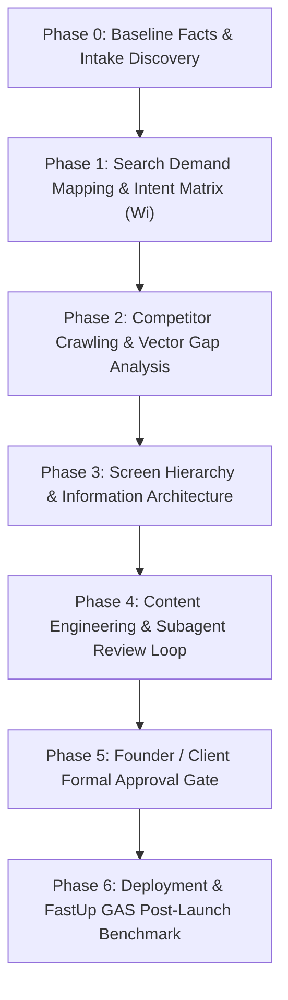
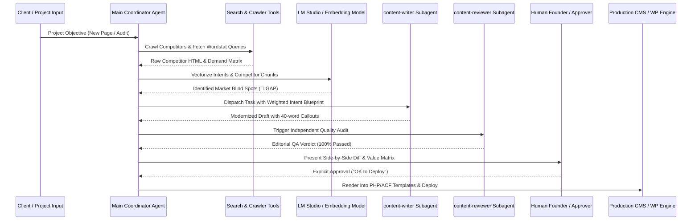

# 📘 FastUp GEO-RAG Framework: Standard Operating Procedure (SOP)
## End-to-End Engineering Methodology for Commercial Intent Mapping, Competitor Reverse-Engineering, and Generative Engine Optimization

> **Document Status:** Active Standard Operating Procedure (SOP v1.0)  
> **Author & System Architect:** FastUp Engineering & Business Mentorship Core  
> **Audience:** Primary Agent, Subagents (`content-writer`, `content-reviewer`), and Internal Operations  
> **Applicability:** FastUp.by Internal Core Pages, Blog Hubs, Client B2B Commercial Projects, Audits & Landing Pages.

---

## 1. Executive Summary & Core Mission

The **FastUp GEO-RAG Framework** is an algorithmic, data-grounded methodology designed to achieve undisputed market leadership across both traditional search engines (Google, Yandex) and generative AI answer engines (ChatGPT Search, Yandex.Neuro, Google AI Overviews, Perplexity, Claude).

### The Primary Objective:
Make every validated client question on a commercial page answerable from a single
self-contained block, so that a retrieval system can extract a correct, specific answer
without reading the rest of the page — and so that a human reader gets the price, term and
guarantee they came for.

### What this framework measures, and what it cannot (revised 2026-08-15)

An earlier version of this document set the objective as "cosine similarity ≥ 0.85 across 100%
of intents, versus a competitor average of 0.30–0.50". That target was removed: it was not
measurable in the sense implied, and two of its three numbers were never computed.

* **Local cosine similarity does not predict citation in ChatGPT, Yandex.Neuro or Google AI.**
  Those systems use their own embeddings, index, reranker, domain authority and third-party
  mentions. A local LM Studio model knows none of that. The local measurement answers exactly
  one question: *does the text of this page cover this client question?* Call it **intent
  coverage**, never "AI visibility".
* **There is no calibrated cosine threshold.** Values are comparable **within one run, between
  pages measured identically**. Absolute cut-offs ("0.85 = market leader", "≤0.50 = market gap")
  are arbitrary and are not used as verdicts.
* **A competitor ranking built on our own metric is circular** — the winner is whoever wrote
  text closest to our phrasing of the query. Internal orientation only. Never published, never
  put in a proposal: besides being weak evidence, naming competitors with unfavourable scores
  carries comparative-advertising risk.
* **Actual AI visibility is measured by querying the AI** — three runs per prompt, counting
  brand presence and factual accuracy: NVI / CBK / PKS in `geo/metric-spec-v1.md`. The local
  measurement supports editing; it does not replace that benchmark.
* **Demand percentages are only "demand" when computed from measured frequencies.** Weights
  assigned by judgement are expert priorities — label them as such, and never build a formula
  on them. If the shares do not sum to 100%, they were not computed.



---

## 2. Core Architectural Principles & Anti-Hallucination Guardrails

### Rule 1: The "No Pink Ponies" Principle (Zero Fabricated Features)
* **Definition:** Never propose, promote, or highlight a feature, guarantee, or differentiator simply because "we can do it" or "the founder thought of it", unless there is **quantifiable search intent demand ($W_i > 0$)** or a direct B2B buying friction identified in customer behavior.
* **Failure Mode to Avoid:** Presenting trivial, non-demanded traits as "unique selling propositions" (USPs). This introduces semantic noise, dilutes vector density, and confuses AI retrieval algorithms.

### Rule 2: Query Decomposition & The "1 H2 = 1 RAG Chunk" Law
* **How AI Search Operates:** Modern generative search engines do not match full long queries as monolithic strings. A query planner decomposes complex user prompts into **3 to 5 parallel sub-queries** (e.g., Pricing $\to$ Legal Rights $\to$ Tech Stack $\to$ Local Regulation).
* **The Solution:** Every $H2$ section on a page must function as an **autonomous, self-contained factual module** containing a calibrated **35–45 word `<!-- geo-callout -->` chunk**. If an LLM extracts only one paragraph from the page, that single paragraph must completely answer that specific sub-query with exact entities, numbers, and terms.

### Rule 3: Ground Truth Over Speculation (The 2-Attempt Verification Rule)
* Speculation and guessing are strictly forbidden. If technical integration, pricing, or search parameters fail twice, the agent **MUST immediately query official documentation** (`search_web`, Google Search Central, Schema.org, WP Codex, legislation) and ground the output on proven reality.

### Rule 4: Weighted Demand Distribution ($W_i$)
* The physical vertical height and information hierarchy of a landing page must strictly mirror the real-world search volume percentages ($W_i$):
  $$Score_{page} = \sum_{i=1}^{n} \left( W_i \times \text{CosineSimilarity}_i \right)$$
* High-volume commercial questions (e.g., Pricing ~35%) must be answered on the top screens (Hero / Block 1). Long-tail technical questions (5–10%) belong in structured FAQ modules.

### Rule 5: Strict Separation of Subagent Execution
* **Main Session:** Project management, orchestration, vector score evaluation, client interaction.
* **`content-writer` Subagent:** Pure copywriting and RAG-chunk engineering. Self-audits against checklist before returning output. Single drop-in draft, no messy multi-choice lists.
* **`content-reviewer` Subagent:** Independent editorial control. Runs strict 5-point QA (Facts, Prices, Callout word counts, AI markers, Legal disclaimers).
* **Founder Gate:** ZERO automatic deployments. Every draft must be reviewed and approved by the human decision-maker before touching production.

---

## 3. End-to-End Execution Pipeline (6 Sequential Phases)



---

### Phase 0: Baseline Facts & Commercial Intake Discovery
Before drafting a single sentence, construct or read the single source of truth for the client/project:
1. **Entity Identification:** Exact Legal Name, Registration Number (UNP/OGRN), Registration Date, Founder/Managing Director names.
2. **Commercial Offering:** Base prices for each package, payment milestones (e.g., 30/40/30), included scope vs. add-on scope.
3. **Legal & Compliance Parameters:** Local hosting regulations (e.g., Belarus Decree No. 60 / BelGIE registry), data privacy, copyright transfer clauses.
4. **Technical Constraints:** Target CMS (WordPress + Tailwind + ACF vs. custom framework), Core Web Vitals targets (PageSpeed $\ge 90$).

---

### Phase 1: Real Search Demand & Weighted Intent Mapping (Wi)
1. Extract search queries from search consoles, keyword planners (Wordstat, GSC, Ahrefs), and conversational LLM query logs.
2. Cluster queries into **5 to 8 distinct Commercial Intent Clusters**.
3. **Demand gate — this step can cancel the page.** Check measured frequency in the *target
   region*, not the aggregate. If demand in the target region is near zero, an optimised page
   will not bring search traffic no matter how well structured it is, and its role must be
   redefined before it is written (sales support, differentiator attached to a service that
   does have demand, or a different market). Documented precedent: Belarus demand for GEO
   queries measured 0–39/month against 59–1304 in Russia
   (`geo/2026-08-13-wordstat-intenty-geo-metriki.md`,
   `content/research/geo-page/INTENT-MAP.md`), and queries for the metrics themselves measured
   zero — so the metrics work inside a sales conversation, not as an acquisition channel.
4. Compute each cluster's weight (Wi) as its share of measured frequency. The shares must sum
   to 100% by construction; if they do not, they were assigned by hand and must be labelled
   **expert priority**, not demand share.
5. When no frequency data exists for a topic, say so explicitly in the map. Do not fill the gap
   with plausible percentages — an invented share propagates into page structure and into
   claims made to clients.
6. The tier pattern below is the **usual ordering by importance to the deal**, not a
   measurement, and never overrides step 4:
   * Direct cost, pricing tables, package tiers — normally the largest cluster.
   * Technology stack, total cost of ownership, speed.
   * Delivery stages, working-day timelines, client approval SLA.
   * Integrations and regulatory compliance.
   * Guarantees, copyright assignment, dispute terms.
7. Output structured file: `geo/MASTER-INTENT-MAP-<YEAR>.json`, with the source of every share
   recorded (measured / expert priority).

---

### Phase 2: Competitor Reverse-Engineering & Vector Gap Analysis
1. Select the **Top 10–12 competitors** in the target geographic market:
   * 3–4 Enterprise Leaders (High domain authority, legacy clients).
   * 4–5 Direct Commercial Competitors (Top 3–15 organic SERP).
   * 3–4 Niche / Low-Cost Competitors.
2. Crawl and store exact corresponding service landing pages in `content/research/competitors/multi_service/`.
3. Slice competitor pages into sliding 70-word semantic chunks (with 15-word overlap).
4. Run embedding computation through `scripts/geo_embed.py` (LM Studio,
   `text-embedding-qwen3-embedding-8b`):
   * Score each page as the **mean of its top-3 chunks** against the intent — not the single
     best chunk, which rewards one keyword-stuffed paragraph.
   * Phrase the intent query **as the client types it**: no brand names, no own prices, no
     registration numbers. If the query reveals whose page it is, the measurement is rigged and
     the result must be discarded. (This exact defect invalidated the 2026-08-15 run.)
   * A missing competitor page is a **dash and a coverage gap**, never 0.000 — a silent zero
     drags averages and fabricates a result that was never measured.
   * Read pages whole. Truncating to the first N chunks cuts long competitor pages and flatters
     our own compact drafts.
   * If LM Studio is unavailable the run **fails loudly**. No report is produced from zeros.
5. Read gaps **relatively**: which questions are covered worse than the same questions elsewhere,
   and which are covered by nobody. No absolute cut-off marks a "market gap"; a low score is a
   prompt to read the page and confirm the gap by eye before acting on it.

---

### Phase 3: Screen Hierarchy & Primacy-Bias Architecture
Order blocks top-to-bottom by the weights established in Phase 1. The percentages quoted below
are the **typical** distribution for a Belarusian B2B service page, carried over as a starting
template — they are not this project's measurement, and Phase 1 replaces them whenever real
frequencies exist. A block earns its place because a client asks that question or raises that
objection, never because "we can do it".

* **Screen 1 (Hero Section):**
  * $H1$: Clear service definition + target region + primary benefit.
  * Subtitle: Technology stack, ownership rights, Core Web Vitals target, guarantee.
  * 3 Fast Bullets: Minimum price anchor | Fixed delivery terms | Core legal trust signal.
* **Screen 2 ($H2$ Block 1 — 35% Demand):**
  * Direct format breakdown (e.g., Landing / Corporate / E-commerce) with exact fixed prices in local currency and delivery times in working days.
* **Screen 3 ($H2$ Block 2 — 25% Demand):**
  * Comparative Total Cost of Ownership (TCO) 3-year calculation table (Clean Code vs. SaaS Builders vs. Heavy CMS).
* **Screen 4 ($H2$ Block 3 — 15% Demand):**
  * Transparent delivery timeline (6 distinct stages) with explicit client approval SLA disclaimers.
* **Screen 5 ($H2$ Block 4 — 10% Demand):**
  * Visual integration matrix (Payment Gateways, Delivery APIs, 1C/ERP, CRM).
* **Screen 6 ($H2$ Block 5 — 10% Demand):**
  * Legal guarantees, 100% intellectual property transfer, founder personal accountability.
* **Screen 7 ($H2$ Block 6 — 5% Demand):**
  * State compliance (BelGIE, Decree No. 60, SSL, Local Data Center).
* **Screen 8 (FAQ Module):**
  * 6 targeted conversational questions formatted for Schema.org `FAQPage`.

---

### Phase 4: Content Engineering & Strict Subagent Review Protocol

#### Content Generation Standards for `content-writer`:
1. **Self-contained opening block.** Every H2 opens with a `<!-- geo-callout -->` paragraph that
   answers that section's question on its own, with the numbers and names inside it — readable
   in isolation, without the rest of the page. Target density is 35–45 words; that is an
   orientation for how much fits into one extractable answer, **not a norm to rewrite good copy
   for**. A 30-word block that answers the question fully passes; a 40-word block that answers
   nothing fails.
2. **Zero Filler:** Never use transition clichés (*"In today's fast-paced world"*, *"It is worth noting"*, *"Crucial aspect"*, *"Swiss knife"*).
3. **Entity Density:** Include real entity names (bePaid, WebPay, WooCommerce, Tailwind CSS, Schema.org, BelGIE, Decree No. 60, IP Voronov E.O., UNP 791438116).
4. **Legal Safety Disclaimers:** Never guarantee "Top-1" in search; state realistic 30–60 day milestones; add client approval delay disclaimers to all calendar schedules.

#### Audit Protocol for `content-reviewer`:
* [ ] **Fact & Price Consistency:** Verified against `facts.md`.
* [ ] **Callout self-sufficiency:** each opening block answers its own question in isolation,
  with concrete numbers and names, around 35–45 words, zero introductory fluff.
* [ ] **Nothing working was dropped:** compare against `content/live-pages/` — a rework easily
  deletes a block the live page already had. Precedent 2026-08-15: result timelines, the SEO+GEO
  link and lead analytics disappeared from the drafts while present on the live pages.
* [ ] **AI Marker Scan:** 0 matches against `ai-detection-markers-checklist.md`. Long dash `—` density $< 6.0$ per 1000 characters.
* [ ] **Legal Protection:** Working days specified, client delay disclaimers included, warranty limited to defect fixes.
* [ ] **Structured Data:** Valid JSON-LD schema provided for `Service`, `Organization`, and `FAQPage`.

---

### Phase 5: Founder / Client Formal Approval Gate
* Generate a side-by-side **Before vs. After coverage report**: our current live text against our
  new draft, measured identically. That is the only honest before/after in the set — our draft
  against a competitor's crawled page (navigation, footer and all) flatters us and is not a
  comparison. Report drops as well as gains; a rework that improves eight questions and loses
  four is not finished.
* Do not promise a target score. No cosine value is a business outcome, and quoting an expected
  figure ("0.621 → 0.850+") invites the reader to treat the proxy as the result.
* Present the complete draft in `content/drafts/`.
* **MANDATORY STOP:** Do not deploy, touch PHP templates, or modify WordPress ACF fields until explicit approval is granted in conversation.

---

### Phase 6: Production Deployment & FastUp GAS Post-Launch Benchmark
1. Map approved draft into dedicated WordPress theme templates (e.g., `design/wp-templates/page-<service>.php`).
2. Sync custom ACF fields (`hero_bullets`, `pricing_tiers`, `tco_table`, `faq_items`).
3. Inject structured JSON-LD Schema.org markup.
4. Execute automated Google Rich Results & W3C validation.
5. Trigger **FastUp GAS Benchmark Engine** across ChatGPT Search, Yandex.Neuro, and Google AI Overviews to calculate live $NVI_{comm}$, $CBK$, and $PKS$ scores.

---

## 4. Reusable Mathematical Formulas

### 1. Neuro-Visibility Index ($NVI_{comm}$):
$$NVI_{comm} = \frac{\sum_{i=1}^{N_{comm}} A_i}{3 \times N_{comm}} \times 100\%$$
*Where $A_i \in \{0, 1, 2, 3\}$ represents brand citation depth in search AI prompt $i$, and $N_{comm}$ is total commercial prompt volume.*

### 2. Corporate Brand Knowledge ($CBK$):
$$CBK = \frac{\sum_{j=1}^{M} S_j}{3 \times M} \times 100\%$$
*Where $S_j \in \{+3, +2, +1, 0, -1\}$ grades factual accuracy of AI answers regarding company credentials and eliminates hallucinations.*

### 3. Person-Keyword Strength ($PKS$):
$$PKS = \frac{\text{Successful Founder Identification Prompts}}{\text{Total Executive Prompts}} \times 100\%$$

---

## 5. Verification Checklist for Any Future Project

```markdown
### Pre-Flight Verification Checklist
- [ ] Demand measured in the TARGET REGION, not the aggregate; near-zero demand handled by
      redefining the page's role rather than optimising it harder.
- [ ] Intent weights either computed from frequencies (shares sum to 100%) or explicitly
      labelled "expert priority".
- [ ] 10+ competitor pages crawled and measured through `scripts/geo_embed.py`.
- [ ] Intent queries contain no own brand, prices or registration numbers.
- [ ] Missing competitor pages shown as gaps, not as 0.000.
- [ ] Gaps confirmed by reading the page, not by a threshold alone.
- [ ] Screen hierarchy mirrors question priority top-to-bottom.
- [ ] Every H2 opens with a self-contained answer block (~35–45 words) carrying its own numbers.
- [ ] Before/after compares our live text to our draft; regressions listed, not only gains.
- [ ] Comparative TCO table calculated with 3-year projection.
- [ ] Local legal & regulatory mandates explicitly addressed.
- [ ] content-writer draft passed 100% QA by content-reviewer.
- [ ] Explicit human approver sign-off recorded.
- [ ] Schema.org JSON-LD validated with zero errors.
```

---
*Document permanently stored in `geo/GEO-RAG-COMMERCIAL-PIPELINE-FRAMEWORK.md`. Synchronized with Git repository `fastup-mentor`.*
